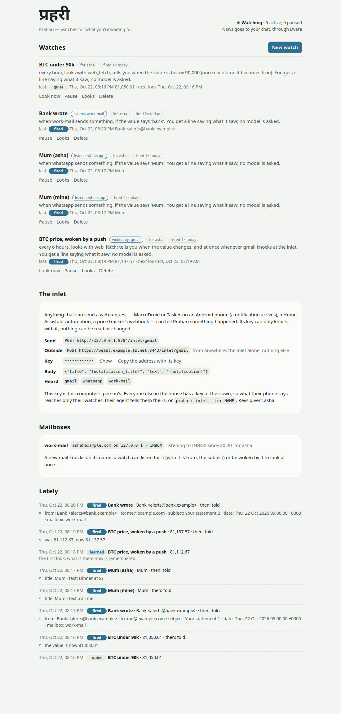

# prahari — tells your agent when something happens

"Tell me when ALAB drops under $50."
"Tell me when a mail from the bank arrives."
"When Mum messages me on WhatsApp, read it to me and draft a reply."

An agent can check any of those once, while you watch. [Samay](https://github.com/kunwarmahen/samay)
can run a check on a schedule, but every run is a whole agent turn: a
model is asked, every hour, to look and say whether anything changed.
Ninety-nine looks in a hundred find nothing, and you pay for all of
them.

**Prahari** watches without a model. Your agent writes a small
*recipe* once, out of tools it already has: which tool to look with,
what to pick out of its answer, and when that matters. Prahari repeats
the look on its own, with no model, and wakes the agent only when the
thing you were waiting for happens. Things that can tell you
themselves, like a phone that just got a notification or a webhook,
knock on Prahari's **inlet** instead, and the same recipe decides.

### Samay or Prahari?

Both repeat things, so they're easy to mix up. The question to ask is
*is this about a time, or about something happening?*

| You say | It's | Use |
|---|---|---|
| "Every morning at 8, summarise my mail" | something done **at a time** | **Samay**: a schedule. At each time, the agent does the whole job |
| "Remind me on Friday to call the plumber" | something done **at a time** | **Samay** |
| "Tell me when ALAB drops under $50" | **waiting** for something to happen | **Prahari**: a watch. It peeks with no model and wakes the agent only when it happens |
| "Tell me as soon as the bank writes" | **waiting** | **Prahari**, with a mailbox that says so the moment mail lands |

A watch's *every 30 minutes* isn't an appointment. It's only how often
Prahari peeks until the thing happens, and a knock (a mailbox, a phone)
can make it peek at once. You don't have to choose yourself: ask your
agent in plain words, and it picks. Its instructions draw the same line.

## The name

**prahari** — प्रहरी (Sanskrit *praharī*; said roughly *pruh-huh-ree*).

A *prahari* is the guard on watch, the sentinel at the gate. The word
comes from *prahara*, a watch of the day or night: the old Indian day
was cut into eight *praharas* of three hours, and a *prahari* kept one.
He doesn't do the household's work. He watches, and when the thing he
was set to watch for comes, he calls whoever must act. That is this
program's whole job.

```
             ┌──────────────────────────────────────────────┐
  a recipe   │  check   one tool call that reads             │
  (the agent │  pick    what to take out of its answer       │
   writes    │  when    below 50 · new · contains Mum · …    │
   it once)  │  every   how often to look                    │
             └──────┬───────────────────────────▲───────────┘
                    │ every 3h, no model         │ an event (the inlet):
                    ▼                            │ MacroDroid, Home Assistant,
       yantra --call TOOL --args JSON            │ a webhook
                    │                            │
                    ▼                            │
          pick → when ── no ──▶ quiet (a row in the logbook, nothing else)
                    │
                   yes
                    ▼
     a line to you (no model)   or   a Yantra turn with `then`
                    └──────── through Dvara, to your chat ────────┘
```

**Prahari never does the work itself.** Every look is one tool call
made by Yantra with no model (`yantra --call`, [Yantra's note 139](https://github.com/kunwarmahen/yantra/blob/main/notes/139-one-tool-no-model.md)),
and when a watch fires, the work is an ordinary Yantra turn. Prahari
starts Yantra as a program and reads the JSON it prints. It imports
nothing from Yantra and has no dependencies of its own.

How it's built, and why: [01 — a watch with no model](notes/01-a-watch-with-no-model.md);
[02 — a watch for everyone, mail that knocks, and a door to the street](notes/02-a-watch-for-everyone.md).

## Works with

* **[Yantra](https://github.com/kunwarmahen/yantra)** makes every look (`yantra --call`) and every
  then-turn (`yantra --json --unattended`). Yantra also finds Prahari by
  itself: with `prahari` on `PATH`, the agent gets the tools to offer
  "I'll tell you when that happens", and you approve each watch on a card
  that says in words what it looks at, how often, and what happens then.
* **[dvara](https://github.com/kunwarmahen/dvara)** carries the news to you: answers go to your
  Telegram, Dvara's web chat and Sarathi's home page through Dvara's
  `/notify`. With `dvara --prahari`, everyone in the house can make a
  watch from the chat, and each one looks as its person, with their own
  accounts (Dvara's `POST /call`).
* **[Setu](https://github.com/kunwarmahen/setu)** is reached through Yantra: a look can use any
  account Setu keeps (a Gmail search, a signed-in site's page, Notion),
  exactly as a turn would.
* **[Sarathi](https://github.com/kunwarmahen/sarathi)** starts it with the rest (`[prahari]` in
  `sarathi.toml`), as a program or a Podman container, and links its
  page from the home page.

## Setup

```bash
uv sync
# Tell Prahari how to start Yantra, and where (Yantra reads .env from there):
export PRAHARI_YANTRA=~/yantra/.venv/bin/yantra
export PRAHARI_YANTRA_HOME=~/yantra
```

Looks need no model at all. The model in Yantra's `.env` is used only
when a watch fires with a `then`, or for a test that asks a yes/no
(`ask`). A local model on Ollama is fine for both: put
`YANTRA_PROVIDER=ollama` and `OLLAMA_MODEL=qwen3.8:latest` in Yantra's
`.env`.

## Using it

```bash
# try a recipe once, before saving anything: what it sees, in words
prahari preview --check mcp__gmail__search_threads \
    --args '{"account": "personal", "query": "from:alerts@bank.example newer_than:2d"}' \
    --pick 'items:thread (\w+)' --when new --every 30m
#   every 30 minutes, looks with mcp__gmail__search_threads; tells you when the list has something new
#   It sees 1 item(s) now; the first look remembers them, and only ones after that are news.

# save it
prahari add "Mail from the bank" --check mcp__gmail__search_threads \
    --args '{"account": "personal", "query": "from:alerts@bank.example newer_than:2d"}' \
    --pick 'items:thread (\w+)' --when new --every 30m

# a price, from a public JSON address, and the agent's view when it drops
prahari add "BTC under 60k" --check web_fetch \
    --args '{"url": "https://api.coinbase.com/v2/prices/BTC-USD/spot"}' \
    --pick 'json:data.amount' --when 'below 60000' --every 1h \
    --then "Tell me the price, and how far it fell this week."

# keep it running (nothing is looked at otherwise)
prahari serve
#   page: http://127.0.0.1:8782/#token=…     open this once; the browser keeps it
#   inlet: http://127.0.0.1:8782/inlet/WORD  (key: prahari inlet)

# mail the moment it lands: a mail account in Setu, its folder kept open (IMAP IDLE)
setu connect mail --as work --mail-server imap.fastmail.com --user me@example.com
#   the mail password (an app password) (not shown):
prahari mailbox add work-mail --account mail:work
#   opened INBOX on imap.fastmail.com as me@example.com (mail:work); kept as work-mail for local
prahari add "The bank wrote" --listen work-mail --pick json:from --when 'contains bank'
# ...or keep a Gmail search as the check, and look at once when mail lands
prahari add "Mail from the bank" --check mcp__gmail__search_threads \
    --args '{"account": "personal", "query": "from:alerts@bank.example newer_than:2d"}' \
    --pick 'items:thread (\w+)' --when new --every 6h --wake work-mail

# see, try, mend, stop
prahari list
prahari looks                  # newest first, every watch
prahari show 1e69              # one watch in full (the first letters of its id will do)
prahari look 1e69              # look once, now, here -- and wait
prahari edit 1e69 --every 2h   # mend its check, pick, test, how often or then
prahari pause 1e69 | resume 1e69 | rm 1e69
```

A real run, against a real inbox and a real price (no model anywhere):

```
$ prahari look 9c7e7378
Thu 22 Oct 08:31  fired      81,633.9  then: told
    • the value is now 81,633.9
$ prahari look 9c7e7378
Thu 22 Oct 08:31  quiet      81,633.9
$ prahari look 1e691992
Thu 22 Oct 08:32  learned    1 item(s)
    the first look: what is there now is remembered
$ prahari look 1e691992
Thu 22 Oct 08:32  quiet      1 item(s)
```

The price watch fired on its first look because the price was already
below its line; the second look was quiet, because a test on a value
fires when it *becomes* true, not every time it *is* true. The mail
watch's first look only learned what was there.

Every command takes `--json`.

### A recipe

**check** — one call of a tool your agent has, with its arguments:
`{"tool": "mcp__gmail__search_threads", "args": {...}}`. It must be a
tool that only reads (a search, a site's page, a screenshot), or the
exact call you accepted: `web_fetch` of one address is allowed because
the watch's card showed you that address, and Prahari passes Yantra a
grant fixing every argument, so a fetch of any other address isn't.
Nothing is granted before you accept, so `preview` can only try a tool
that reads.

**pick** — what to take out of the answer:

| Short form | JSON | Takes |
|---|---|---|
| `number` | `{"number": ""}` | the first number |
| `number:Last\s*([\d.,]+)` | `{"number": "Last\\s*([\\d.,]+)"}` | the number a pattern finds (group 1), or the first one after it |
| `text:status: (\w+)` | `{"text": "status: (\\w+)"}` | a piece of text |
| `json:data.amount` | `{"json": "data.amount"}` | a value from JSON (`a.b[0].c`, `list[*].id`) |
| `items:thread (\w+)` | `{"items": "thread (\\w+)"}` | every match is an item; group 1 is its key |
| `items_json:messages[*]:id` | `{"items_json": "messages[*]", "key": "id"}` | items from a JSON list |
| (nothing) | `{}` | the whole answer |

**when** — when it matters:

| | |
|---|---|
| `below 50`, `above 50`, `at_most 50`, `at_least 50` | numbers; fires when it becomes true, and again only after it was false in between |
| `contains Mum`, `lacks In stock`, `equals shipped`, `matches REGEX` | text; the same edge |
| `changed` | the value isn't what it was last time |
| `new` | items not seen before (by their key) |
| `any` | every time (an inlet's event, usually) |
| `ask is this an invoice?` | a yes/no for a model, asked only about a value that changed or items that are new |

**every** — `30m`, `3h`, `1d`: five minutes at the least, seven days at
the most (less often than that is a schedule, and Samay's job: see
*Samay or Prahari?* above).

**wake** — a word at the inlet that makes a watch that looks look *now*,
not only every `every`: a mailbox's name, or the word Gmail's push
knocks on. The knock only says "look"; its body isn't read, so a sender
can't put words into the watch. A knock while it's looking makes one
more look after, never a pile.

**renew** — with `wake`, a call that keeps the sender knocking, made when
the watch starts and once a day: Gmail's push lasts seven days. It runs
on the watch's own road, granted word for word like the check; one that
fails is `failed`, and is tried again in an hour.

**then** — what the agent is asked when it fires, with nobody watching.
Leave it out, and you get a line saying what was seen, with no model
asked at all.

A mistake is refused before anything is saved, with what to write
instead:

```
$ prahari add x --check t --when 'belw 50'
error: when is one of: below N, above N, at_most N, at_least N, equals X, contains X,
lacks X, matches REGEX, changed, new, any, ask QUESTION -- not 'belw 50'
```

### The inlet

Some things can tell you themselves. Your Android phone gets a
WhatsApp notification the moment Mum writes; a Home Assistant
automation knows the instant the door opens; a price tracker
(Keepa, CamelCamelCamel) can call a webhook. Polling any of those would
be slower and wasteful. Instead, they knock:

```bash
prahari add "Mum on WhatsApp" --listen whatsapp --pick json:title --when 'contains Mum' \
    --then "Read me what Mum said, and draft a reply I can send."
prahari inlet
#   send to:   POST http://127.0.0.1:8782/inlet/WORD
#   with:      Authorization: Bearer <key>
#      or:     http://127.0.0.1:8782/inlet/WORD?key=<key>
#   listening: whatsapp

curl -X POST "http://127.0.0.1:8782/inlet/whatsapp?key=<key>" \
     -H 'Content-Type: application/json' -d '{"title": "Mum", "text": "Dinner at 8?"}'
#   {"heard_by": 1}
```

**On an Android phone, with MacroDroid** (Tasker works the same way):

1. Trigger: *Notification received*, application WhatsApp (or any app).
2. Action: *HTTP request*, method POST, to
   `http://<your computer>:8782/inlet/whatsapp?key=<key>`, content type
   `application/json`, body
   `{"title": "[notification_title]", "text": "[notification]"}`.
3. Your computer's address is the one Sarathi's `[house]` name gives
   (`linux-al-ml-beast.local`), or its LAN address; the phone must be
   able to reach port 8782 (Sarathi's `up` prints the firewall line).

That's all: the phone tells Prahari, the watch decides, and the agent
answers in your chat. No polling, nothing unofficial logged in to
WhatsApp, and nothing read from your phone that you didn't send.

**Each person has their own key.** The key above is this computer's
person's. Anyone else in the house gets one of their own
(`prahari inlet --for asha`, or their agent's `inlet_address` tool), and
a knock is heard only by the watches of the person whose key it came
with: Asha's phone saying "Mum: dinner at 8?" never fires your watch for
Mum. `--new-key` replaces one that leaked.

**The inlet's key can only knock.** It goes into apps and webhook
settings, where keys leak, so it isn't the page's token: with it,
something can be *said* to Prahari, and nothing can be read, made,
changed or deleted. What is said is matched against the watches you
already set up, and fires only those. It answers `202` at once, with
how many watches heard it; the deciding happens behind, because a test
that asks a model may take a minute, and a phone app sending a
notification shouldn't wait. The same body twice inside ten minutes is
one event (an `id` in the body, if the sender has one, is better). A
JSON object is read as it is, a form is made one, and anything else is
`{"text": ...}`; 16 KB at most.

`prahari hear WORD JSON [--for NAME]` sends the inlet something on this
computer without the network, to try a watch before you set up the
phone. A Google Cloud Pub/Sub push is read through its envelope: its
base64 `data` is the event, and its message id the event's `id`.

At most 60 knocks a minute for one key; the 61st hears `429`.

### Mail, the moment it lands

A watch on mail looks every 15–30 minutes. Two things can say so the
moment a mail lands, and both knock on the inlet, as their person:

**A mailbox Prahari keeps open (IMAP IDLE)**, any mail server: Gmail,
Fastmail, iCloud, Outlook, your own.

```bash
# 1. the account, in Setu (or its page's Mail (IMAP) card), once
setu connect mail --as work --mail-server imap.gmail.com --user me@gmail.com
# 2. the mailbox, here
prahari mailbox add work-mail --account mail:work [--for asha]
prahari mailbox list
#   work-mail    local      mail:work: me@gmail.com on imap.gmail.com INBOX  [listening]
#                listening to INBOX since 08:14 (Thu 22 Oct 08:14)
prahari mailbox rm work-mail          # the account stays in Setu
```

**The password stays in Setu.** Setu asks for it, hidden: for Gmail,
iCloud and Outlook an *app password* (your account's security settings
make one), never your own. It's kept in your Setu folder like every
other sign-in, under your lock if you set one. Prahari keeps only the
account's name. Each time it opens the folder it asks Setu for the login
(`setu login mail:work --json`), holds it in memory while the
connection is open, and sends it nowhere but the mail server, over TLS.
Change the password in Setu, and the next connection uses it. Someone
else in the house adds the account in their own Setu folder (their
Setu link from Dvara's `/accounts page`, the same Mail card). Their
mailbox (`--for asha`) gets its login through Dvara, which knows their
folder and holds the key they unlocked it with. While `prahari serve`
runs, each new mail knocks on the mailbox's name with its `from`, `to`,
`subject`, `date` and `id`, never a word of what it says, and nothing
is marked read. The first connection only learns what's there. Mail
that came while it was down knocks when it's back, once each.

**Gmail's own push**, through Google Cloud Pub/Sub. This one needs the
public inlet (below), because Pub/Sub delivers by calling an address:

```bash
# in the Google Cloud project whose client Setu signs in to Gmail with
gcloud services enable pubsub.googleapis.com
gcloud pubsub topics create gmail-push
gcloud pubsub topics add-iam-policy-binding gmail-push \
    --member=serviceAccount:gmail-api-push@system.gserviceaccount.com \
    --role=roles/pubsub.publisher
gcloud pubsub subscriptions create prahari-gmail --topic=gmail-push \
    --push-endpoint="https://<your computer>.<tailnet>.ts.net:8443/inlet/gmail?key=<your inlet key>"

# the watch: its check, woken by Gmail, and the call that keeps Gmail telling
prahari add "Mail from the bank" --check mcp__gmail__search_threads \
    --args '{"account": "personal", "query": "from:alerts@bank.example newer_than:2d"}' \
    --pick 'items:thread (\w+)' --when new --every 6h --wake gmail \
    --renew mcp__gmail__watch_mailbox \
    --renew-args '{"account": "personal", "topic": "projects/<project>/topics/gmail-push"}'
```

Gmail tells the topic only your address and a number, never mail text;
the knock wakes the watch, and its own search says what's new.
`watch_mailbox` is Setu's, on every Gmail level.

### The inlet from outside the house

The inlet is on the house's network. A webhook from the internet (Gmail's
push, a price tracker, IFTTT) needs it reachable from outside, and
nothing else should be:

```bash
prahari serve --inlet-port 8783 --inlet-public-url https://<computer>.<tailnet>.ts.net:8443
#   inlet alone: https://<computer>.<tailnet>.ts.net:8443/inlet/WORD
deploy/public-inlet-tailscale.sh 8783      # you run it: it signs in to Tailscale
```

`--inlet-port` opens a second listener with **the inlet alone**: `POST
/inlet/WORD` with a key, and 404 for the page and every `/api` path,
whatever token is offered. It listens on 127.0.0.1, and Tailscale Funnel
carries a public HTTPS name to it: no domain, no open router port, and
Tailscale holds the certificate. The script serves it on 8443, so a Setu
catalog on 443 keeps its own. Undo with `sudo tailscale funnel
--https=8443 off`. `prahari inlet` and the page show both addresses.

**What the inlet can't do.** An iPhone doesn't let other apps read its
notifications, so there's no WhatsApp road there. And Prahari doesn't
log in to WhatsApp itself: the unofficial WhatsApp Web clients that
would let it are against WhatsApp's terms, and personal numbers get
banned for them.

### The page

`prahari serve` serves a page at the address it prints: every watch in
words, when it looks next and what it saw last, with **Look now**,
**Pause** / **Resume**, **Looks** (its history) and **Delete**; the
inlet's address, its key behind **Show**, and the body for MacroDroid;
and **Lately**, the last looks across all watches. **New watch** writes
one by hand, and **Try it** looks once and says what it sees before
anything is saved.



It listens on localhost only (`--host` to change that), and every API
request needs the page's token, for the reason Samay's page gives: any
website you visit can send a request to 127.0.0.1. The token comes
after the `#` in the printed address, which a browser never sends to a
server.

```
GET    /api/status                       is it watching; how many watches
GET    /api/watches                      every watch, with its last look
POST   /api/preview   {check|listen, pick, when, every, sample}   try it once
POST   /api/watches   {name, check|listen, pick, when, every, then, ...}
PATCH  /api/watches/ID   {check, pick, when, every, then, name, max_per_day}
POST   /api/watches/ID/pause | /resume | /look     (look answers 202 at once)
DELETE /api/watches/ID
GET    /api/looks?watch=ID&limit=N       newest first
GET    /api/inlet                        the inlet's addresses, key, words, people with keys
GET    /api/mailboxes                    the mail folders kept open (no passwords)
POST   /inlet/WORD                       the inlet (an inlet key; also on --inlet-port alone)
```

### Your agent writes the recipe

The best moment to set up a watch is in the middle of a conversation:
"let me know when that's back in stock". `prahari mcp` is an MCP server
with the tools an agent uses:

```bash
prahari mcp --for local --agent ~/agents/reader     # what a harness starts
```

| Tool | |
|---|---|
| `preview_watch` | looks ONCE (only with a tool that reads) and says what it sees, with the start of the tool's answer |
| `list_watches`, `watch_looks` | what this person is watching, and what each saw |
| `inlet_address` | where this person's phone or webhook sends, with their own key |
| `create_watch` | saves one, after the person agreed |
| `update_watch` | mends one: a site moved its price, so the pick needs changing |
| `allow_for_watch` | lets a watch's then-turn use a tool it was refused |
| `pause_watch`, `resume_watch`, `delete_watch` | |

**The agent writes the recipe; you accept it.** The four reading tools
say they only read, and the six that change something don't, so Yantra
asks you before each one, on a card in words. `preview_watch` comes
first and answers with the start of what the tool said, so a model whose
pick found nothing sees why and writes a better one before you are asked
anything.

**One person per server.** `--for`, `--agent` and `--runner` are the
harness's to set; the model has no argument with which to name anyone
else.

### The rules

Each one is there because of a way an unwatched watch goes wrong
([notes/01](notes/01-a-watch-with-no-model.md)):

| | |
|---|---|
| **The first look only learns** | a new "tell me about new mail" would otherwise fire on the whole inbox. A test on a value ("below 50") is about now, so if it's already true you hear at once |
| **A test on a value fires on its edge** | "below 50" tells you once when the price goes under, not every three hours while it stays there |
| **New is by key** | the same mail is news once, across restarts |
| **Ask the model last** | `ask` sends only what changed or is new, never the whole answer every look |
| **A broken check never fires** | a tool that failed, or a pick that found nothing (the site moved its price), is `failed` or `broken`, never quiet. Three in a row pause the watch, and you're told how to mend it |
| **A sign-in wall pauses at once** | an expired login doesn't fix itself before the next look |
| **A limit per day** | at most `max_per_day` fires (10 unless you say) in any 24 hours; past it, kept and not run, and you're told once |
| **A late look is just a look** | asleep at the due time, Prahari looks once when it wakes; it never replays a backlog |
| **What was found is outside text** | the then-turn is given it inside a block marked as text to read and never to obey: a mail or a page can say anything |
| **A look is its person's** | on the Dvara road a look goes to Dvara as the watch's person, with their own accounts; never this computer's |
| **A knock is its person's** | a knock is heard only by the watches of the person whose key (or mailbox) it came from |
| **A knock only says look** | a watch woken by its word looks with its own check; the knock's body is never read |

### Where news goes

With `PRAHARI_DVARA_URL` set, a fire is sent to the watch's person
through Dvara (`POST /notify`): their Telegram, Dvara's web chat,
Sarathi's home page. A watch made at this computer (`local`) goes to
`PRAHARI_DVARA_ACTOR`; Sarathi sets it to its owner. Without a Dvara,
looks are kept for `prahari looks` and the page, and nothing is sent.

A then-turn runs here (`--runner direct`, the default: Yantra as a
program, its questions put to you in your chat when a Dvara is set) or
through Dvara as a person (`--runner dvara --as NAME`: their allowance,
their rules, `came_by: prahari` on Dvara's page). On the Dvara road the
look goes there too: `POST /call` builds the person's agent with their
own Setu folder and runs the one call with no model (Dvara's notes/56).
So a guest's watch reads the guest's mail, never yours, and Dvara can
offer watches to everyone.

## Settings

| Variable | What |
|---|---|
| `PRAHARI_STATE` | where watches and looks are kept (default `~/.prahari`; also `--state`) |
| `PRAHARI_YANTRA` | the command that starts Yantra; may be several words |
| `PRAHARI_YANTRA_HOME` | the folder Yantra starts in, for its `.env` |
| `PRAHARI_DVARA_URL`, `PRAHARI_DVARA_TOKEN` | where Dvara is, and its `DVARA_TOKEN`: news is sent, and `--runner dvara` works |
| `PRAHARI_DVARA_ACTOR` | who a watch made here is for |
| `PRAHARI_MAX_WATCHES` | how many watches one person may have (default 30) |
| `PRAHARI_TOKEN` | the page's token, instead of the one kept in the state folder |
| `PRAHARI_INLET_TOKEN` | the inlet's key, instead of the one kept in the state folder |
| `PRAHARI_PUBLIC_URL` | where a browser reaches the page when that isn't where it is bound (a container's port mapping) |
| `PRAHARI_SETU` | the command that starts Setu, for a mailbox's login (default: `setu` beside Prahari, else on PATH) |
| `PRAHARI_INLET_PORT` | the inlet alone on this port, for the public road (also `--inlet-port`) |
| `PRAHARI_INLET_PUBLIC_URL` | where the internet reaches that inlet: its Tailscale Funnel name (also `--inlet-public-url`) |

Everything is in one SQLite file, `~/.prahari/prahari.sqlite3`; no
password is ever kept here (a mailbox's is in Setu). Each
watch's looks work in a folder of their own, `~/.prahari/work/<id>`.

### Keeping it running

```bash
prahari unit --install        # a systemd user unit, and an env file (yours alone)
systemctl --user daemon-reload
systemctl --user enable --now prahari
```

`--install` copies this shell's `PRAHARI_*` and `YANTRA_*` settings and
its `PATH` into `~/.config/prahari/prahari.env`, readable by you alone;
it starts nothing. Sarathi users don't need this: `sarathi up` runs it.

## The source

```
src/prahari/
├── recipe.py    the recipe's form: pick (number, text, json, items) and when
│                (below, contains, changed, new, any, ask), checked with
│                the known keys named, and applied to a tool's answer
├── store.py     the SQLite file: watches (the promise), looks (the receipt),
│                seen (keys already told), each person's inlet key, mailboxes
├── watches.py   make, mend, pause, find, a cap per person; preview, which
│                looks once with nothing granted
├── clock.py     the rules above; the loop prahari serve runs; the inlet's
│                events; firing: a line, or a then-turn with what was found
│                marked as outside text
├── looking.py   Yantra as a program: the look (yantra --call, granted word
│                for word), the yes/no for ask, the then-turn (Samay's
│                direct road); Roads, each watch's look on its own road
├── dvara.py     the Dvara road: /call for a look as the person, /notify for
│                news, /message for a turn as the person (came_by prahari).
│                Standard library only ([notes/02](notes/02-a-watch-for-everyone.md))
├── mailbox.py   mail pushed: a Setu mail account's folder kept open with
│                IMAP IDLE, each new mail's headers a knock as its person; the
│                login asked of Setu (or Dvara, for another person) each time
├── http.py      the page, its JSON API (the page's token), and the inlet
│                (keys of their own, one a person, that can only knock; a
│                Pub/Sub push unwrapped; 60 knocks a minute); the inlet
│                alone on a port of its own, for the public road
├── static/      the page: one file and its icon, nothing fetched
deploy/
└── public-inlet-tailscale.sh   the inlet alone on a public HTTPS name (Funnel)
├── mcp.py       the agent's tools, for one person (stdio MCP, by hand)
├── status.py    prahari status --json: here, watching (a lock, not a pid)
├── unit.py      prahari unit: a systemd user unit
└── cli.py       the commands above
```

## Status

The watch, its rules, the inlet, mailboxes kept open, Gmail's push, the
inlet alone for the public road, the page and the agent's tools work,
and are covered by 151 tests. The API is not stable.

Run for real: a watch on a real mail account, made from the chat,
fired and woke the agent.

Not run for real yet: Gmail's push against Google (it needs a Pub/Sub
topic and the public name), IMAP IDLE against a real mail server (a
local test server stands in, [notes/02](notes/02-a-watch-for-everyone.md)),
and the Funnel script.

## Tests

```bash
uv run pytest -q          # offline: a fake caller, a fake runner, a fake
                          #   yantra on a real process, the page and the inlet
                          #   on local sockets, prahari mcp as a real process,
                          #   a small mail server for IDLE, and a fake Dvara
```
