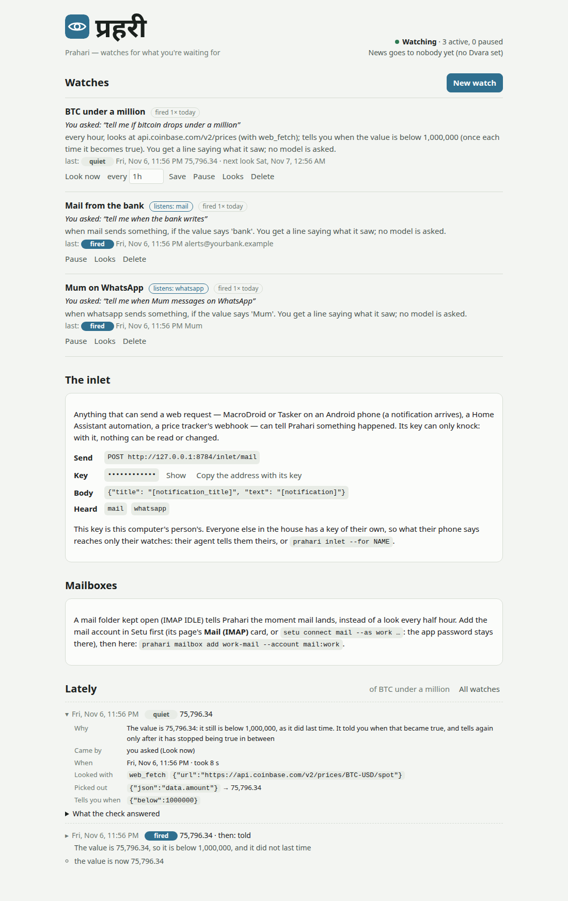

# prahari — tells your agent when something happens

"Tell me when ALAB drops under $50."
"Tell me when a mail from the bank arrives."
"When Mum messages me on WhatsApp, read it to me and draft a reply."

An agent can check any of those once, while you watch. [Samay](https://github.com/kunwarmahen/samay)
can run a check on a schedule, but every run is a whole agent turn: a
model is asked, every hour, to look and say whether anything changed.
Ninety-nine looks in a hundred find nothing, and you pay for all of
them.

**Prahari** watches without a model. Your agent writes a small
*recipe* once, out of tools it already has: which tool to look with,
what to pick out of its answer, and when that matters. Prahari repeats
the look on its own, with no model, and wakes the agent only when the
thing you were waiting for happens. Things that can tell you
themselves, like a phone that just got a notification or a webhook,
knock on Prahari's **inlet** instead, and the same recipe decides.

A number several things want — the outside temperature, a price — can
be an **indriya**: a reading Prahari keeps up to date with one call,
which any number of watches *sense* and any agent reads, instead of each
calling out on its own.

### Samay or Prahari?

Both repeat things, so they're easy to mix up. The question to ask is
*is this about a time, or about something happening?*

| You say | It's | Use |
|---|---|---|
| "Every morning at 8, summarise my mail" | something done **at a time** | **Samay**: a schedule. At each time, the agent does the whole job |
| "Remind me on Friday to call the plumber" | something done **at a time** | **Samay** |
| "Tell me when ALAB drops under $50" | **waiting** for something to happen | **Prahari**: a watch. It peeks with no model and wakes the agent only when it happens |
| "Tell me as soon as the bank writes" | **waiting** | **Prahari**, with a mailbox that says so the moment mail lands |

A watch's *every 30 minutes* isn't an appointment. It's only how often
Prahari peeks until the thing happens, and a knock (a mailbox, a phone)
can make it peek at once. You don't have to choose yourself: ask your
agent in plain words, and it picks. Its instructions draw the same line.

## The name

**prahari** — प्रहरी (Sanskrit *praharī*; said roughly *pruh-huh-ree*).

A *prahari* is the guard on watch, the sentinel at the gate. The word
comes from *prahara*, a watch of the day or night: the old Indian day
was cut into eight *praharas* of three hours, and a *prahari* kept one.
He doesn't do the household's work. He watches, and when the thing he
was set to watch for comes, he calls whoever must act. That is this
program's whole job.

```
             ┌──────────────────────────────────────────────┐
  a recipe   │  check   one tool call that reads             │
  (the agent │  pick    what to take out of its answer       │
   writes    │  when    below 50 · new · contains Mum · …    │
   it once)  │  every   how often to look                    │
             └──────┬───────────────────────────▲───────────┘
                    │ every 3h, no model         │ an event (the inlet):
                    ▼                            │ MacroDroid, Home Assistant,
       yantra --call TOOL --args JSON            │ a webhook
                    │                            │
                    ▼                            │
          pick → when ── no ──▶ quiet (a row in the logbook, nothing else)
                    │
                   yes
                    ▼
     a line to you (no model)   or   a Yantra turn with `then`
                    └──────── through Dvara, to your chat ────────┘
```

**Prahari never does the work itself.** Every look is one tool call
made by Yantra with no model (`yantra --call`, [Yantra's note 139](https://github.com/kunwarmahen/yantra/blob/main/notes/139-one-tool-no-model.md)),
and when a watch fires, the work is an ordinary Yantra turn. Prahari
starts Yantra as a program and reads the JSON it prints. It imports
nothing from Yantra and has no dependencies of its own.

How it's built, and why: [01 — a watch with no model](notes/01-a-watch-with-no-model.md);
[02 — a watch for everyone, mail that knocks, and a door to the street](notes/02-a-watch-for-everyone.md);
[03 — a watch says what it is for](notes/03-a-watch-says-what-it-is-for.md);
[04 — a watch has its days](notes/04-a-watch-has-its-days.md);
[05 — a look says why](notes/05-a-look-says-why.md).

## Works with

* **[Yantra](https://github.com/kunwarmahen/yantra)** makes every look (`yantra --call`) and every
  then-turn (`yantra --json --unattended`). Yantra also finds Prahari by
  itself: with `prahari` on `PATH`, the agent gets the tools to offer
  "I'll tell you when that happens", and you approve each watch on a card
  that says in words what it looks at, how often, and what happens then.
* **[dvara](https://github.com/kunwarmahen/dvara)** carries the news to you: answers go to your
  Telegram, Dvara's web chat and Sarathi's home page through Dvara's
  `/notify`. With `dvara --prahari`, everyone in the house can make a
  watch from the chat, and each one looks as its person, with their own
  accounts (Dvara's `POST /call`).
* **[Setu](https://github.com/kunwarmahen/setu)** is reached through Yantra: a look can use any
  account Setu keeps (a Gmail search, a signed-in site's page, Notion),
  exactly as a turn would.
* **[Sarathi](https://github.com/kunwarmahen/sarathi)** starts it with the rest (`[prahari]` in
  `sarathi.toml`), as a program or a Podman container, and links its
  page from the home page.

## Setup

```bash
uv sync
# Tell Prahari how to start Yantra, and where (Yantra reads .env from there):
export PRAHARI_YANTRA=~/yantra/.venv/bin/yantra
export PRAHARI_YANTRA_HOME=~/yantra
```

Looks need no model at all. The model in Yantra's `.env` is used only
when a watch fires with a `then`, or for a test that asks a yes/no
(`ask`). A local model on Ollama is fine for both: put
`YANTRA_PROVIDER=ollama` and `OLLAMA_MODEL=qwen3.8:latest` in Yantra's
`.env`.

## Using it

```bash
# try a recipe once, before saving anything: what it sees, in words
prahari preview --check mcp__gmail__search_threads \
    --args '{"account": "personal", "query": "from:alerts@bank.example newer_than:2d"}' \
    --pick 'items:thread (\w+)' --when new --every 30m
#   every 30 minutes, looks with mcp__gmail__search_threads for 'from:alerts@bank.example newer_than:2d'; tells you when the list has something new
#   It sees 1 item(s) now; the first look remembers them, and only ones after that are news.

# save it
prahari add "Mail from the bank" --check mcp__gmail__search_threads \
    --args '{"account": "personal", "query": "from:alerts@bank.example newer_than:2d"}' \
    --pick 'items:thread (\w+)' --when new --every 30m \
    --asked "tell me when the bank writes"

# a price, from a public JSON address, and the agent's view when it drops
prahari add "BTC under 60k" --check web_fetch \
    --args '{"url": "https://api.coinbase.com/v2/prices/BTC-USD/spot"}' \
    --pick 'json:data.amount' --when 'below 60000' --every 1h --thing "BTC's price" \
    --then "Tell me the price, and how far it fell this week."

# keep it running (nothing is looked at otherwise)
prahari serve
#   page: http://127.0.0.1:8782/#token=…     open this once; the browser keeps it
#   inlet: http://127.0.0.1:8782/inlet/WORD  (key: prahari inlet)

# mail the moment it lands: a mail account in Setu, its folder kept open (IMAP IDLE)
setu connect mail --as work --mail-server imap.fastmail.com --user me@example.com
#   the mail password (an app password) (not shown):
prahari mailbox add work-mail --account mail:work
#   opened INBOX on imap.fastmail.com as me@example.com (mail:work); kept as work-mail for local
prahari add "The bank wrote" --listen work-mail --pick json:from --when 'contains bank'
# ...or keep a Gmail search as the check, and look at once when mail lands
prahari add "Mail from the bank" --check mcp__gmail__search_threads \
    --args '{"account": "personal", "query": "from:alerts@bank.example newer_than:2d"}' \
    --pick 'items:thread (\w+)' --when new --every 6h --wake work-mail

# see, try, mend, stop
prahari list
prahari looks                  # newest first, every watch, each with why
prahari looks 1e69 --full      # one watch's looks, with what the check answered
prahari show 1e69              # one watch in full (the first letters of its id will do)
prahari look 1e69              # look once, now, here -- and wait
prahari edit 1e69 --every 2h   # mend its check, pick, test, how often or then
                               # (how often alone keeps what it saw)
prahari pause 1e69 | resume 1e69 | rm 1e69
```

A real run, against a real inbox and a real price (no model anywhere):

```
$ prahari look 9c7e7378
Thu 22 Oct 08:31  fired      81,633.9  then: told
    • the value is now 81,633.9
$ prahari look 9c7e7378
Thu 22 Oct 08:31  quiet      81,633.9
$ prahari look 1e691992
Thu 22 Oct 08:32  learned    1 item(s)
    the first look: what is there now is remembered
$ prahari look 1e691992
Thu 22 Oct 08:32  quiet      1 item(s)
```

The price watch fired on its first look because the price was already
below its line; the second look was quiet, because a test on a value
fires when it *becomes* true, not every time it *is* true. The mail
watch's first look only learned what was there.

Every look keeps a sentence saying **why** it ended as it did, which
`prahari looks` prints under it:

```
Fri 6 Nov 21:45  quiet      55
    why: The temperature is 55: it still is below 60, as it did last time. It told
    you when that became true, and tells again only after it has stopped being true
    in between
```

and the start of what the check answered (`--full` shows it). A watch
that stays quiet when you think it shouldn't usually says why here: the
pick read something else, the model said no, or the question never got
an answer ([notes/05](notes/05-a-look-says-why.md)).

### Both sides of a number: two watches

*"Heat the guestroom below 60 °F outside, cool it above 70 °F"* is two
watches on one check, one line each, each with a `then` of its own. A
line needs no model and fires once as it is crossed. An `ask` would put
the question to a model on every hourly change instead
([notes/05](notes/05-a-look-says-why.md#a-band-is-two-watches)):

```bash
prahari add "Guestroom heat when below 60°F" --check web_fetch \
  --args '{"url": "https://api.open-meteo.com/v1/forecast?latitude=35.79&longitude=-78.78&current=temperature_2m&temperature_unit=fahrenheit"}' \
  --pick 'json:current.temperature_2m' --when 'below 60' --every 1h \
  --thing "the outside temperature" \
  --asked "heat the guestroom below 60 outside, cool it above 70" \
  --runner dvara --agent minder --as owner \
  --then "The outside temperature has gone below 60°F. Set the guestroom thermostat to heat: call mcp__homeassistant-home__call_service with domain='climate', service='set_hvac_mode', entity_id='climate.guestroom_thermostat', data={'hvac_mode': 'heat'}. Keep the existing setpoint. Then tell the person the outside temperature (give the value) and that the guestroom thermostat is now set to heat."

prahari add "Guestroom cool when above 70°F" --check web_fetch \
  --args '{"url": "https://api.open-meteo.com/v1/forecast?latitude=35.79&longitude=-78.78&current=temperature_2m&temperature_unit=fahrenheit"}' \
  --pick 'json:current.temperature_2m' --when 'above 70' --every 1h \
  --thing "the outside temperature" \
  --asked "heat the guestroom below 60 outside, cool it above 70" \
  --runner dvara --agent minder --as owner \
  --then "The outside temperature has gone above 70°F. Set the guestroom thermostat to cool: call mcp__homeassistant-home__call_service with domain='climate', service='set_hvac_mode', entity_id='climate.guestroom_thermostat', data={'hvac_mode': 'cool'}. Keep the existing setpoint. Then tell the person the outside temperature (give the value) and that the guestroom thermostat is now set to cool."
```

The second one is let in although it shares the first's check and pick,
because its line is on the other side. A second `below` on the same
number would be refused as the same watch. Use the entity id your Home
Assistant shows for the thermostat. Change a line later with `prahari
edit ID --when 'above 72'`, rather than adding the watch again.

A `--runner dvara` watch asks Dvara for its agents when it is made, so
`add` needs `PRAHARI_DVARA_URL` and `PRAHARI_DVARA_TOKEN` in the shell
it runs in. When Prahari runs in Sarathi's containers and you type at
your own terminal, Dvara is on 127.0.0.1:8770 and the token is the
container's:

```bash
PRAHARI_DVARA_URL=http://127.0.0.1:8770 \
PRAHARI_DVARA_TOKEN=$(podman exec sarathi-prahari printenv PRAHARI_DVARA_TOKEN) \
prahari add "Guestroom cool when above 70°F" --check web_fetch …
```

The watch is kept in `~/.prahari`, the same file the container reads,
and the container's `prahari serve` looks at it from then on. Watches
asked for in a chat need none of this: the agent makes them through
Prahari itself.

### One reading, many watches: indriyas

The band above calls the weather service twice an hour for one number.
An **indriya** (इन्द्रिय, *a sense*; said *in-dree-yuh*) is the looking
half of a watch on its own: one call, a pick, how often. It keeps the
value it took, with a time on it, and its recent history. Watches
**sense** it instead of looking, and your agent answers "how cold is it
outside?" from it, with no call at all
([notes/06](notes/06-one-reading-many-watches.md)):

```bash
prahari indriya add outside-temp --check web_fetch \
  --args '{"url": "https://api.open-meteo.com/v1/forecast?latitude=35.79&longitude=-78.78&current=temperature_2m,relative_humidity_2m&temperature_unit=fahrenheit"}' \
  --pick json:current.temperature_2m --thing "the outside temperature" --every 15m
#   added indriya outside-temp: reads the outside temperature every 15 minutes:
#   looks at api.open-meteo.com/v1/forecast (with web_fetch)

prahari add "Heat the guestroom" --sense outside-temp --when 'below 60' --then "…"
prahari add "Cool the guestroom" --sense outside-temp --when 'above 70' --then "…"
prahari add "Damp outside" --sense outside-temp \
  --pick json:current.relative_humidity_2m --thing "the humidity" --when 'above 50'

prahari indriya look outside-temp      # read once, now; each watch decides on it
#   Sun 8 Nov 17:23  read       56.9
#   29fa64b3  Sun 8 Nov 17:23  fired      56.9  then: told
#   7f184479  Sun 8 Nov 17:23  learned    56.9
#   63e8fd74  Sun 8 Nov 17:23  fired      57  then: told

prahari indriya list                   # every reading, its value and age, who senses it
prahari indriya list --as asha --json  # as asha sees them: her own, then the house's
prahari indriya get outside-temp --json
prahari indriya readings outside-temp  # what happened: each reading, how it came, and what
                                       # every watch decided on it (--full: why, what came in)
prahari indriya edit outside-temp --every 30m    # also --check/--args/--pick/--share
prahari indriya pause outside-temp | resume outside-temp | rm outside-temp
```

One call out; three watches decided, and the humidity watch picked its
own number from the same answer. A watch that senses has no `--check`,
`--every` or `--wake` of its own: how often is the indriya's. When a
reading fails, each watch that senses it says so on its own looks, but
only the indriya counts it: three in a row pause the indriya, and you're
told which watches went quiet with it. An indriya a watch still senses
can't be removed.

**Shared with the house, or not.** An indriya reads with your accounts.
`--share house` lets everyone's watches and agents read its *value*. It
never lets them call anything as you, or change it. It starts as
`mine`. `list`, `get` and `readings` take `--as PERSON` to answer as
that person sees them, which is how Dvara's `/indriyas` asks, so a
private reading never reaches someone else's list.

**Or from a template.** A reading somebody already wrote, with blanks:
fill them and it is yours, read with your accounts on your road
([notes/11](notes/11-a-reading-from-a-template.md)). Four come with
Prahari (the outside temperature and the air quality from Open-Meteo, a
coin's price from Coinbase, a Home Assistant sensor sent in); a
marketplace (Vidhi's, `VIDHI_MARKET`) lists more, each reviewed and
signed, installed only if a reviewer you trust signed it:

```bash
prahari indriya templates [--market]
prahari indriya install outside-temp --input latitude=35.79 --input longitude=-78.78
#   added indriya outside-temp from outside-temp: reads the outside temperature every
#   15 minutes: looks at api.open-meteo.com/v1/forecast (with web_fetch)
prahari indriya install coin-price --name eth --input coin=ETH --every 30m
prahari indriya install eth-price --from-market     # signed, checked against your trust list
```

A blank in an address is one value: `Cary&key=x` arrives as
`Cary%26key%3Dx` and can't add a parameter. The page's **From a
template** button and the agent's `indriya_templates` and
`install_indriya_template` do the same.

**One call stays one call, by itself.** A new watch on exactly the call
an indriya already makes senses it instead, and says so; one that asked
to look more often speeds up your own indriya to its pace (never someone
else's: a house reading slower than asked is left alone, and the watch
looks itself). `--look-itself` makes it call on its own anyway. Watches
you made *before* the indriya move only when you say so, and keep what
they remembered when the indriya makes the same call, so the guestroom's
heat watch doesn't tell you 46 °F a second time:

```bash
prahari indriya add outside-temp --from-watch aa5afa6c   # its call, pick and pace;
#   watches of yours on this same call (each still calls itself):
#     aa5afa6c  Heat the guestroom
#     f243cf84  Cool the guestroom
prahari edit aa5afa6c --sense outside-temp                # one by one, or
prahari indriya add outside-temp --from-watch aa5afa6c --move   # all at once
prahari edit aa5afa6c --look-itself                       # and back to its own call
```

**A pace given back.** Each watch that sped a reading up keeps how often
it asked; when it is removed, ends, or goes back to its own call, the
reading slows to the slowest pace still wanted (your own `--every`, or
the fastest watch left), and says so. Your `--every` is the last word.
A site that asks for fewer calls gets a floor, kept once for the house:
new watches and readings faster than it are refused, and setting it slows
what already calls faster
([notes/12](notes/12-a-pace-given-back.md)):

```bash
prahari floor set open-meteo.com 15m --why "their free tier"   # host (and subdomains) or a tool
prahari floor list
prahari floor rm open-meteo.com                                  # back to 5 minutes
```

The same from a page: `/api/floors` (below), which Sarathi's Settings uses.

**Fresh on asking.** `prahari indriya get outside-temp --max-age 5m`
(and `read_indriya`'s `max_age`, and `?max_age=` on the API) reads it
again first when the kept value is older than that, with the call you
already said yes to. Never within 5 minutes of the last reading (or the
site's floor), whoever asks, and a fresh read fires nothing: the next reading on the
clock decides for the watches.

**Sent in, when the thing can say itself.** A Home Assistant thermometer
knows the guestroom's temperature better than any page Prahari could
read. A *pushed* indriya makes no call; its value is sent to the inlet
with your inlet key, and each one reaches its watches as a reading would
([notes/08](notes/08-a-value-sent-in.md)):

```bash
prahari indriya add guestroom-temp --pushed --thing "the guestroom temperature in °F" --every 30m
#   send it values: POST http://…:8782/inlet/indriya/guestroom-temp   with {"value": 68.2}
prahari indriya push guestroom-temp 61.5      # try it here, as the sender would
prahari indriya push guestroom-temp 61.5 --at 2026-11-09T08:40:00-05:00   # measured then
```

A value may say when it was measured: `{"value": 61.5, "at": "…"}` (ISO
8601 with a zone, or seconds since 1970). Its age is counted from then,
and one measured before the value already kept is **late**: in the
history, never kept or handed to the watches, so a queue sent after the
network came back doesn't fire a watch on the past.

Home Assistant sends it with a `rest_command` posting `{"value": "{{
states('sensor.guestroom_temperature') }}"}`, from an automation that
runs on every change *and* every 20 minutes. The whole setup, with the
key kept in `secrets.yaml` and a first try from Developer tools, is in
[notes/08](notes/08-a-value-sent-in.md#from-home-assistant) (and,
step by step, in Sarathi's tutorial).

`--every` is how often a value is *expected*. Nothing by then is a failed
reading, said on each watch; `unavailable` or `unknown` (Home Assistant's
words for a sensor that dropped off) is too, and three in a row pause it
and tell you. A value arriving after it paused for silence starts it
again. A knock reaches only its own key's person's indriyas.

**Unused, it stops.** An indriya no watch has decided on and nobody has
asked for in 30 days pauses, and you're told. `resume` gives it another
month.

**What happened to it.** Each reading says how it came (its clock, by
hand, asked for fresh, sent in, or nothing came in time) and what every
watch on it decided, so *"why didn't my guestroom watch fire?"* has one
answer: **Readings** under each indriya on this page and on Yantra's
Watches panel, `/indriyas 2` in a chat, `read_indriya` for the agent
([notes/09](notes/09-what-happened-to-a-reading.md)). Readings from before
looks kept which one they judged show their watches *matched by time*.

**The agent knows they're there.** Yantra names each reading the person
may use in its prompt (what it reads and how often, never the value,
which would be stale in minutes), so *"how cold is it outside?"* is
answered from `read_indriya` instead of another weather call. The
Watches panel on Yantra's page lists them beside the watches, and in a
chat `/indriyas` does.

Every command takes `--json`.

### A recipe

**check** — one call of a tool your agent has, with its arguments:
`{"tool": "mcp__gmail__search_threads", "args": {...}}`. It must be a
tool that only reads (a search, a site's page, a screenshot), or the
exact call you accepted: `web_fetch` of one address is allowed because
the watch's card showed you that address, and Prahari passes Yantra a
grant fixing every argument, so a fetch of any other address isn't.
That holds for a `bash` check too, quotes and all: a command like
`python3 "/path/outside_temp.py" 35.79 -78.78` is granted exactly as
written (a quote inside the grant is `\"`), and any other command is not.
Nothing is granted before you accept, so `preview` can only try a tool
that reads.

**pick** — what to take out of the answer:

| Short form | JSON | Takes |
|---|---|---|
| `number` | `{"number": ""}` | the first number |
| `number:Last\s*([\d.,]+)` | `{"number": "Last\\s*([\\d.,]+)"}` | the number a pattern finds (group 1), or the first one after it |
| `text:status: (\w+)` | `{"text": "status: (\\w+)"}` | a piece of text |
| `json:data.amount` | `{"json": "data.amount"}` | a value from JSON (`a.b[0].c`, `list[*].id`) |
| `items:thread (\w+)` | `{"items": "thread (\\w+)"}` | every match is an item; group 1 is its key |
| `items_json:messages[*]:id` | `{"items_json": "messages[*]", "key": "id"}` | items from a JSON list |
| (nothing) | `{}` | the whole answer |

**when** — when it matters:

| | |
|---|---|
| `below 50`, `above 50`, `at_most 50`, `at_least 50` | numbers; fires when it becomes true, and again only after it was false in between |
| `contains Mum`, `lacks In stock`, `equals shipped`, `matches REGEX` | text; the same edge |
| `changed` | the value isn't what it was last time |
| `new` | items not seen before (by their key) |
| `any` | every time (an inlet's event, usually) |
| `ask is this an invoice?` | a yes/no for a model, asked only about a value that changed or items that are new |

**every** — `30m`, `3h`, `1d`: five minutes at the least, seven days at
the most (less often than that is a schedule, and Samay's job: see
*Samay or Prahari?* above).

**wake** — a word at the inlet that makes a watch that looks look *now*,
not only every `every`: a mailbox's name, or the word Gmail's push
knocks on. The knock only says "look"; its body isn't read, so a sender
can't put words into the watch. A knock while it's looking makes one
more look after, never a pile.

**renew** — with `wake`, a call that keeps the sender knocking, made when
the watch starts and once a day: Gmail's push lasts seven days. It runs
on the watch's own road, granted word for word like the check; one that
fails is `failed`, and is tried again in an hour.

**asked** and **thing** — what the watch is for, and what its pick
takes, so you can tell later what it watches. `--asked` is what you asked
for, in your own words: it is shown first wherever the watch is, and
ends every message it sends. `--thing` names the number ("the fare",
"the temperature"), so a message says *the fare is now 58* instead of
*the number is now 58*. An agent must give a name and `asked`, copied
from your message word for word; it gives `asked` to `preview_watch`
too, which reads it back (*Its messages will begin: You asked: "…"*) so
words you never said are caught before your yes. By hand both are yours
to leave out.

**from**, **until** and **stop** — a watch's days. `--from` is when it
starts looking (before then it makes no look); `--until` is when it ends
by itself; `--stop` ends it once what it sees passes a test, in the same
words as `--when` (`contains Landed`). An ended watch tells you, looks no
more, and is kept 30 days, then removed with its looks; `prahari edit ID
--keep` (or *keep it* to the agent) brings it back. A watch with none of
these asks you once, after 30 days, whether you still want it — it goes
on looking — and `--keep` stops the question for another 30. Nothing
here asks first: you agreed to the end when you agreed to the watch.

```bash
# the fare for Saturday's flight: no use after Saturday
prahari add "Phoenix nonstop under $571" --check browser_open \
    --args '{"url": "https://www.google.com/travel/flights?..."}' \
    --pick 'number:Nonstop.*?\$([\d,]+)' --when 'below 571' --every 6h \
    --thing "the fare" --until 2026-10-31T23:59

# a flight tomorrow: from the morning until it lands
prahari add "AA 1042 tomorrow" --check web_fetch --args '{"url": "https://..."}' \
    --pick 'text:Status: (\w+)' --when changed --every 30m \
    --from 2026-10-31T06:00 --until 2026-11-01T00:00 --stop 'contains Landed'
```

**then** — what the agent is asked when it fires, with nobody watching.
Leave it out, and you get a line saying what was seen, with no model
asked at all.

A mistake is refused before anything is saved, with what to write
instead:

```
$ prahari add x --check t --when 'belw 50'
error: when is one of: below N, above N, at_most N, at_least N, equals X, contains X,
lacks X, matches REGEX, changed, new, any, ask QUESTION -- not 'belw 50'
```

### The inlet

Some things can tell you themselves. Your Android phone gets a
WhatsApp notification the moment Mum writes; a Home Assistant
automation knows the instant the door opens; a price tracker
(Keepa, CamelCamelCamel) can call a webhook. Polling any of those would
be slower and wasteful. Instead, they knock:

```bash
prahari add "Mum on WhatsApp" --listen whatsapp --pick json:title --when 'contains Mum' \
    --then "Read me what Mum said, and draft a reply I can send."
prahari inlet
#   send to:   POST http://127.0.0.1:8782/inlet/WORD
#   with:      Authorization: Bearer <key>
#      or:     http://127.0.0.1:8782/inlet/WORD?key=<key>
#   listening: whatsapp

curl -X POST "http://127.0.0.1:8782/inlet/whatsapp?key=<key>" \
     -H 'Content-Type: application/json' -d '{"title": "Mum", "text": "Dinner at 8?"}'
#   {"heard_by": 1}
```

**On an Android phone, with MacroDroid** (Tasker works the same way):

1. Trigger: *Notification received*, application WhatsApp (or any app).
2. Action: *HTTP request*, method POST, to
   `http://<your computer>:8782/inlet/whatsapp?key=<key>`, content type
   `application/json`, body
   `{"title": "[notification_title]", "text": "[notification]"}`.
3. Your computer's address is the one Sarathi's `[house]` name gives
   (`linux-al-ml-beast.local`), or its LAN address; the phone must be
   able to reach port 8782 (Sarathi's `up` prints the firewall line).
   If the phone also knocks over a VPN, use your router's name for the
   computer instead: `.local` is only found on the Wi-Fi itself.

That's all: the phone tells Prahari, the watch decides, and the agent
answers in your chat. No polling, nothing unofficial logged in to
WhatsApp, and nothing read from your phone that you didn't send.

**Each person has their own key.** The key above is this computer's
person's. Anyone else in the house gets one of their own
(`prahari inlet --for asha`, or their agent's `inlet_address` tool), and
a knock is heard only by the watches of the person whose key it came
with: Asha's phone saying "Mum: dinner at 8?" never fires your watch for
Mum. `--new-key` replaces one that leaked.

**The inlet's key can only knock.** It goes into apps and webhook
settings, where keys leak, so it isn't the page's token: with it,
something can be *said* to Prahari, and nothing can be read, made,
changed or deleted. What is said is matched against the watches you
already set up, and fires only those. It answers `202` at once, with
how many watches heard it; the deciding happens behind, because a test
that asks a model may take a minute, and a phone app sending a
notification shouldn't wait. The same body twice inside ten minutes is
one event (an `id` in the body, if the sender has one, is better). A
JSON object is read as it is, a form is made one, and anything else is
`{"text": ...}`; 16 KB at most.

`prahari hear WORD JSON [--for NAME]` sends the inlet something on this
computer without the network, to try a watch before you set up the
phone. A Google Cloud Pub/Sub push is read through its envelope: its
base64 `data` is the event, and its message id the event's `id`.

At most 60 knocks a minute for one key; the 61st hears `429`.

### Mail, the moment it lands

A watch on mail looks every 15–30 minutes. Two things can say so the
moment a mail lands, and both knock on the inlet, as their person:

**A mailbox Prahari keeps open (IMAP IDLE)**, any mail server: Gmail,
Fastmail, iCloud, Outlook, your own.

```bash
# 1. the account, in Setu (or its page's Mail (IMAP) card), once
setu connect mail --as work --mail-server imap.gmail.com --user me@gmail.com
# 2. the mailbox, here
prahari mailbox add work-mail --account mail:work [--for asha]
prahari mailbox list
#   work-mail    local      mail:work: me@gmail.com on imap.gmail.com INBOX  [listening]
#                listening to INBOX since 08:14 (Thu 22 Oct 08:14)
prahari mailbox rm work-mail          # the account stays in Setu
```

**The password stays in Setu.** Setu asks for it, hidden: for Gmail,
iCloud and Outlook an *app password* (your account's security settings
make one), never your own. It's kept in your Setu folder like every
other sign-in, under your lock if you set one. Prahari keeps only the
account's name. Each time it opens the folder it asks Setu for the login
(`setu login mail:work --json`), holds it in memory while the
connection is open, and sends it nowhere but the mail server, over TLS.
Change the password in Setu, and the next connection uses it. Someone
else in the house adds the account in their own Setu folder (their
Setu link from Dvara's `/accounts page`, the same Mail card). Their
mailbox (`--for asha`) gets its login through Dvara, which knows their
folder and holds the key they unlocked it with. While `prahari serve`
runs, each new mail knocks on the mailbox's name with its `from`, `to`,
`subject`, `date` and `id`, never a word of what it says, and nothing
is marked read. The first connection only learns what's there. Mail
that came while it was down knocks when it's back, once each.

**Gmail's own push**, through Google Cloud Pub/Sub. This one needs the
public inlet (below), because Pub/Sub delivers by calling an address:

```bash
# in the Google Cloud project whose client Setu signs in to Gmail with
gcloud services enable pubsub.googleapis.com
gcloud pubsub topics create gmail-push
gcloud pubsub topics add-iam-policy-binding gmail-push \
    --member=serviceAccount:gmail-api-push@system.gserviceaccount.com \
    --role=roles/pubsub.publisher
gcloud pubsub subscriptions create prahari-gmail --topic=gmail-push \
    --push-endpoint="https://<your computer>.<tailnet>.ts.net:8443/inlet/gmail?key=<your inlet key>"

# the watch: its check, woken by Gmail, and the call that keeps Gmail telling
prahari add "Mail from the bank" --check mcp__gmail__search_threads \
    --args '{"account": "personal", "query": "from:alerts@bank.example newer_than:2d"}' \
    --pick 'items:thread (\w+)' --when new --every 6h --wake gmail \
    --renew mcp__gmail__watch_mailbox \
    --renew-args '{"account": "personal", "topic": "projects/<project>/topics/gmail-push"}'
```

Gmail tells the topic only your address and a number, never mail text;
the knock wakes the watch, and its own search says what's new.
`watch_mailbox` is Setu's, on every Gmail level.

### The inlet from outside the house

The inlet is on the house's network. A webhook from the internet (Gmail's
push, a price tracker, IFTTT) needs it reachable from outside, and
nothing else should be:

```bash
prahari serve --inlet-port 8783 --inlet-public-url https://<computer>.<tailnet>.ts.net:8443
#   inlet alone: https://<computer>.<tailnet>.ts.net:8443/inlet/WORD
deploy/public-inlet-tailscale.sh 8783      # you run it: it signs in to Tailscale
```

`--inlet-port` opens a second listener with **the inlet alone**: `POST
/inlet/WORD` with a key, and 404 for the page and every `/api` path,
whatever token is offered. It listens on 127.0.0.1, and Tailscale Funnel
carries a public HTTPS name to it: no domain, no open router port, and
Tailscale holds the certificate. The script serves it on 8443, so a Setu
catalog on 443 keeps its own. Undo with `sudo tailscale funnel
--https=8443 off`. `prahari inlet` and the page show both addresses.

**What the inlet can't do.** An iPhone doesn't let other apps read its
notifications, so there's no WhatsApp road there. And Prahari doesn't
log in to WhatsApp itself: the unofficial WhatsApp Web clients that
would let it are against WhatsApp's terms, and personal numbers get
banned for them.

### The page

`prahari serve` serves a page at the address it prints: every watch in
words, when it looks next and what it saw last, with **Look now**, an
**every** box and **Save** to change how often it looks (30m, 3h, 1d;
no less than 5 minutes), **Pause** / **Resume**, **Looks** (its history) and **Delete**.
A watch that senses an indriya says which (*senses: outside-temp*) and has
no **Look now** or **every** of its own; **Indriyas** lists each reading
with its value, how old it is, which watches sense it, **Read now** and
**Pause** / **Resume**.
Every look opens on a click: why it was quiet, told you or failed, what
went wrong, the check, the pick and what it picked out, what happened
then, and what the check answered; a watch's **last:** line opens its
newest look. Then the
inlet's address, its key behind **Show**, and the body for MacroDroid;
and **Lately**, the last looks across all watches. **New watch** writes
one by hand, and **Try it** looks once and says what it sees before
anything is saved.



It listens on localhost only (`--host` to change that), and every API
request needs the page's token, for the reason Samay's page gives: any
website you visit can send a request to 127.0.0.1. The token comes
after the `#` in the printed address, which a browser never sends to a
server.

```
GET    /api/status                       is it watching; how many watches
GET    /api/watches                      every watch, with its last look
POST   /api/preview   {check|listen|sense, pick, when, every, sample}   try it once
POST   /api/watches   {name, check|listen|sense, pick, when, every, then, ...}
PATCH  /api/watches/ID   {check, pick, when, every, then, name, max_per_day}
POST   /api/watches/ID/pause | /resume | /look     (look answers 202 at once)
DELETE /api/watches/ID
GET    /api/looks?watch=ID&limit=N       newest first
GET    /api/inlet                        the inlet's addresses, key, words, people with keys
GET    /api/mailboxes                    the mail folders kept open (no passwords)
GET    /api/indriyas                     every indriya, with its value, age, who senses it
GET    /api/indriyas/NAME                one, by name or id
GET    /api/indriyas/NAME/readings?limit=N   its history, newest first, each with what its watches decided
POST   /api/indriyas/NAME/look | /pause | /resume   (look answers 202 at once)
GET    /api/floors                       every site's floor
POST   /api/floors    {site, every, why}  set one; slows what calls faster, and says which
DELETE /api/floors/SITE                  back to the five-minute floor
POST   /inlet/WORD                       the inlet (an inlet key; also on --inlet-port alone)
POST   /inlet/indriya/NAME               a value for a pushed indriya: {"value": 68.2} or the number alone
```

### Your agent writes the recipe

The best moment to set up a watch is in the middle of a conversation:
"let me know when that's back in stock". `prahari mcp` is an MCP server
with the tools an agent uses:

```bash
prahari mcp --for local --agent ~/agents/reader     # what a harness starts
prahari mcp --for asha --zone Europe/London        # someone not on this computer's clock
```

`--zone` is the person's own clock: a start or end given with no offset
is on it, and every day and time their watches say is said on it.

| Tool | |
|---|---|
| `preview_watch` | looks ONCE (only with a tool that reads) and says what it sees, with the start of the tool's answer, and reads back `asked` as the watch's messages will say it |
| `list_watches`, `watch_looks` | what this person is watching, and what each saw |
| `inlet_address` | where this person's phone or webhook sends, with their own key |
| `create_watch` | saves one, after the person agreed: with a `name` they will know it by and `asked`, their own words; a second watch on the same call and pick is refused, naming the first (a line on the other side of the same number is allowed: a band is two watches); on a call an indriya already makes it senses that indriya and says so (`look_itself: true` for its own call); `routine` starts one of the person's Vidhi routines when it fires, instead of `then` |
| `update_watch` | mends one: a site moved its price, so the pick needs changing; `keep: true` when the person says to keep one that ended or asked whether it's still wanted; `sense` moves one that calls itself onto an indriya, and `look_itself: true` moves it back to its own call (the person's own indriya only); `routine` gives it a routine to start (a `then` takes it away) |
| `allow_for_watch` | lets a watch's then-turn use a tool it was refused |
| `pause_watch`, `resume_watch`, `delete_watch` | |
| `list_indriyas`, `read_indriya` | the readings this person may use (their own and the house's), each with its value and how old it is; the description tells the model to answer from a fresh one instead of calling the tool again; `max_age` reads it again first when it's older (not within 5 minutes, or the site's floor) |
| `create_indriya` | keeps a reading up to date, after `preview_watch` tried its call and pick and the person said yes; then watches are made with `sense` instead of a check. `from_watch` takes a watch's call, pick and pace; `move` moves the person's watches on that call onto it, on their word. `pushed: true` makes one whose value is sent in, and its answer has the person's address and key |
| `indriya_templates` | readings ready to install, each with what it calls and its blanks: the ones that come with Prahari, and with `market: true` the marketplace's ([notes/11](notes/11-a-reading-from-a-template.md)) |
| `install_indriya_template` | makes the person's own indriya from one, its blanks filled; `from_market` fetches it and is refused unless a reviewer they trust signed it |
| `update_indriya`, `delete_indriya` | mend or remove one of this person's own (removing is refused while a watch senses it) |

`create_watch` and `preview_watch` take `sense` (an indriya's name) in
place of a check, and `preview_watch` says when a reading already makes
the call, so the person hears it before saying yes.

**The agent writes the recipe; you accept it.** The six reading tools
say they only read, and the nine that change something don't, so Yantra
asks you before each one, on a card in words. `preview_watch` comes
first and answers with the start of what the tool said, so a model whose
pick found nothing sees why and writes a better one before you are asked
anything.

**One person per server.** `--for`, `--agent` and `--runner` are the
harness's to set; the model has no argument with which to name anyone
else.

### The rules

Each one is there because of a way an unwatched watch goes wrong
([notes/01](notes/01-a-watch-with-no-model.md)):

| | |
|---|---|
| **The first look only learns** | a new "tell me about new mail" would otherwise fire on the whole inbox. A test on a value ("below 50") is about now, so if it's already true you hear at once |
| **A test on a value fires on its edge** | "below 50" tells you once when the price goes under, not every three hours while it stays there |
| **New is by key** | the same mail is news once, across restarts |
| **Ask the model last** | `ask` sends only what changed or is new, never the whole answer every look |
| **No answer is not a no** | a question the model never answered is a `failed` look, not a quiet one, and the next look asks about the same value again ([notes/05](notes/05-a-look-says-why.md)) |
| **Every look says why** | quiet, fired, learned or failed, a look keeps one sentence saying why and the start of what the check answered, on the page, in `prahari looks` and to your agent ([notes/05](notes/05-a-look-says-why.md)) |
| **A broken check never fires** | a tool that failed, or a pick that found nothing (the site moved its price), is `failed` or `broken`, never quiet. Three in a row pause the watch, and you're told how to mend it. A broken look shows the start of what the tool said |
| **A site that said no isn't a broken recipe** | when a look comes back turned away — a browser look refused (Yantra's `(HTTP 403: … refused this browser` line), or a shop's bot check standing where the page should be ("Verifying the device...", "Just a moment...", "Press & Hold") — the look is `failed`, says so, and is never judged: a pick of all of it would otherwise call the bot check quiet. The first one looks again within the hour; after that the watch keeps its own pace, and it pauses after five turned away in a row, not three. A browser watch turned away is pointed at a spare phone's browser (`mcp__sparsh__open_url`), which most shops let through (Yantra's notes/151) |
| **A sign-in wall pauses at once** | an expired login doesn't fix itself before the next look |
| **A limit per day** | at most `max_per_day` fires (10 unless you say) in any 24 hours; past it, kept and not run, and you're told once |
| **A watch says what it is for** | every message carries your own words and where it looks — `You asked: "keep an eye on the nonstop to Phoenix"` then `(tells you when the fare is below 571; looks at google.com/travel/flights every 6 hours · watch 9b904bc4)`. A watch made with no name is named by its page and line, never after the tool it looks with ([notes/03](notes/03-a-watch-says-what-it-is-for.md)) |
| **A watch has its days** | `starts`, `ends` and `stop` (a flight that landed): nothing is looked at before it starts, and one whose end came ends and says so, with no yes asked — it was agreed with the watch. Ended, it's kept 30 days, then removed; with no end at all, it asks once a month whether it's still wanted ([notes/04](notes/04-a-watch-has-its-days.md)) |
| **One thing, one watch** | a second watch on the same call and pick is refused, naming the first: mend that one instead. Two watches on one fare, under names nobody chose, is how you stop knowing which is which |
| **A band is two watches** | one number watched from both sides — heat below 60, cool above 70 — is two watches on the same check, one line each, each with its own `then`. Each fires once as its line is crossed, with no model asked to decide; a second line the *same* way is still refused ([notes/05](notes/05-a-look-says-why.md)) |
| **One reading, many watches** | an indriya reads once for every watch that senses it, and each watch is judged on the whole answer by the rules above, as if it had looked itself. A failed reading is said on each watch's looks and counted once, against the indriya; one a watch still senses is never removed ([notes/06](notes/06-one-reading-many-watches.md)) |
| **A value sent in can go quiet** | a pushed indriya's value comes only with the key of its own person; silence past its every, or "unavailable", is a failed reading said on each watch, three pause it and tell its owner, and the sender coming back starts it again ([notes/08](notes/08-a-value-sent-in.md)) |
| **One call stays one call** | a new watch on a call an indriya makes senses it, and a faster one speeds up only the person's own indriya; older watches move only on the person's word, keeping what they remembered; a fresh read is never made within 5 minutes of the last and fires nothing; 30 days unused, it pauses ([notes/07](notes/07-one-call-by-itself.md)) |
| **A pace is given back** | each watch that sped a reading up keeps how often it asked; when it goes (removed, ended, back to its own call) the reading slows to the slowest pace still wanted, and the owner's `--every` is the last word. A site's floor is never gone under, by a new watch, an old one, a speed-up or a fresh read. A value measured before the one kept is history, not news: it fires nothing ([notes/12](notes/12-a-pace-given-back.md)) |
| **A late look is just a look** | asleep at the due time, Prahari looks once when it wakes; it never replays a backlog |
| **What was found is outside text** | the then-turn is given it inside a block marked as text to read and never to obey: a mail or a page can say anything |
| **A look is its person's** | on the Dvara road a look goes to Dvara as the watch's person, with their own accounts; never this computer's |
| **A knock is its person's** | a knock is heard only by the watches of the person whose key (or mailbox) it came from |
| **A knock only says look** | a watch woken by its word looks with its own check; the knock's body is never read |

### Where news goes

**Then, a routine.** Instead of `--then`, a watch can start one of the
person's routines in [Vidhi](https://github.com/kunwarmahen/vidhi):
steps they drew once, which may fetch more, ask the model, and ask them
yes or no before acting.

```bash
prahari add "Porch is cold" --sense porch-temp --when 'below 60' --routine coat-check
```

When it fires, Prahari runs `vidhi start coat-check --as <the watch's
person> --by prahari:<id> --found 58`. `--input room=porch` (repeatable;
`routine_inputs` from the agent) gives this watch its own values for the
routine's blanks, so one routine serves the porch and the guestroom
(`prahari edit ID --input room=` drops one). What it saw goes in as the
routine's `found` input when it has one: the value itself, or the new
items for a `new` watch. The routine tells the person what it did, so
the watch sends nothing of its own; one that didn't start is told, with
why. A watch either asks the agent or starts a routine, never both
([notes/10](notes/10-then-a-routine.md)).

With `PRAHARI_DVARA_URL` set, a fire is sent to the watch's person
through Dvara (`POST /notify`): their Telegram, Dvara's web chat,
Sarathi's home page. A watch made at this computer (`local`) goes to
`PRAHARI_DVARA_ACTOR`; Sarathi sets it to its owner. Without a Dvara,
looks are kept for `prahari looks` and the page, and nothing is sent.

A then-turn runs here (`--runner direct`, the default: Yantra as a
program, its questions put to you in your chat when a Dvara is set) or
through Dvara as a person (`--runner dvara --as NAME`: their allowance,
their rules, `came_by: prahari` on Dvara's page, and the watch's name
as `label`, so a step on a phone says *Prahari: Mayfield ice cream ·
asha* on Sparsh's page; here, Yantra is given it as `YANTRA_ASKED_BY`
for the look and the turn alike). On the Dvara road the
look goes there too: `POST /call` builds the person's agent with their
own Setu folder and runs the one call with no model (Dvara's notes/56).
So a guest's watch reads the guest's mail, never yours, and Dvara can
offer watches to everyone.

## Settings

| Variable | What |
|---|---|
| `PRAHARI_STATE` | where watches and looks are kept (default `~/.prahari`; also `--state`) |
| `PRAHARI_YANTRA` | the command that starts Yantra; may be several words |
| `PRAHARI_YANTRA_HOME` | the folder Yantra starts in, for its `.env` |
| `PRAHARI_DVARA_URL`, `PRAHARI_DVARA_TOKEN` | where Dvara is, and its `DVARA_TOKEN`: news is sent, and `--runner dvara` works (`add` asks Dvara for its agents, so it needs them too) |
| `PRAHARI_DVARA_ACTOR` | who a watch made here is for |
| `PRAHARI_MAX_WATCHES` | how many watches one person may have (default 30) |
| `PRAHARI_MAX_INDRIYAS` | how many indriyas one person may have (default 30) |
| `PRAHARI_TOKEN` | the page's token, instead of the one kept in the state folder |
| `PRAHARI_INLET_TOKEN` | the inlet's key, instead of the one kept in the state folder |
| `PRAHARI_PUBLIC_URL` | where a browser reaches the page when that isn't where it is bound (a container's port mapping) |
| `PRAHARI_SETU` | the command that starts Setu, for a mailbox's login (default: `setu` beside Prahari, else on PATH) |
| `PRAHARI_INLET_PORT` | the inlet alone on this port, for the public road (also `--inlet-port`) |
| `PRAHARI_INLET_PUBLIC_URL` | where the internet reaches that inlet: its Tailscale Funnel name (also `--inlet-public-url`) |

Everything is in one SQLite file, `~/.prahari/prahari.sqlite3`; no
password is ever kept here (a mailbox's is in Setu). Each
watch's looks work in a folder of their own, `~/.prahari/work/<id>`.
`prahari keeps --json` (`prahari.keeps.v1`) says so to a backup
(Sarathi's `sarathi backup`): the state folder, inlet key and all, so a
restored house keeps its senders. The running watch's record
(`serve.json`) stays out. It answers before the file is opened.

### Keeping it running

```bash
prahari unit --install        # a systemd user unit, and an env file (yours alone)
systemctl --user daemon-reload
systemctl --user enable --now prahari
```

`--install` copies this shell's `PRAHARI_*` and `YANTRA_*` settings and
its `PATH` into `~/.config/prahari/prahari.env`, readable by you alone;
it starts nothing. Sarathi users don't need this: `sarathi up` runs it.

## The source

```
src/prahari/
├── recipe.py    the recipe's form: pick (number, text, json, items) and when
│                (below, contains, changed, new, any, ask), checked with
│                the known keys named, and applied to a tool's answer
├── store.py     the SQLite file: watches (the promise), looks (the receipt),
│                seen (keys already told), each person's inlet key, mailboxes,
│                indriyas and their readings
├── watches.py   make, mend, pause, find, a cap per person, one watch per
│                call and pick; preview, which looks once with nothing
│                granted ([notes/03](notes/03-a-watch-says-what-it-is-for.md))
├── templates.py a reading with blanks: the ones that come with Prahari
│                (templates/), or a marketplace's through `vidhi market get`;
│                filled in, a blank in an address quoted
│                ([notes/11](notes/11-a-reading-from-a-template.md))
├── indriyas.py  shared readings: make, mend, find (own first, then the
│                house's), never removed while sensed; their words and age
│                ([notes/06](notes/06-one-reading-many-watches.md)); made from
│                a watch, found for a new watch on the same call, sped up to
│                the fastest need, read fresh on asking, unused for a month
│                ([notes/07](notes/07-one-call-by-itself.md)); slowed back down
│                when a watch's wish goes, older history matched by time
│                ([notes/12](notes/12-a-pace-given-back.md))
├── floors.py    the least time between two calls to one site (a host or a
│                tool), kept for the house; refused below, slowed down to
│                ([notes/12](notes/12-a-pace-given-back.md))
├── clock.py     the rules above; the loop prahari serve runs; an indriya's
│                readings, handed to each watch that senses it; a watch's
│                days (it ends, asks, is removed); each look's why and
│                what its check answered ([notes/05](notes/05-a-look-says-why.md)); the inlet's
│                events; firing: a line that says what it is for, a
│                then-turn with what was found marked as outside text, or
│                a routine started ([notes/10](notes/10-then-a-routine.md))
├── looking.py   Yantra as a program: the look (yantra --call, granted word
│                for word), the yes/no for ask, the then-turn (Samay's
│                direct road); Roads, each watch's look on its own road;
│                start_routine: `vidhi start` as the watch's person
├── dvara.py     the Dvara road: /call for a look as the person, /notify for
│                news, /message for a turn as the person (came_by prahari,
│                the watch's name as label, for the phone's log).
│                Standard library only ([notes/02](notes/02-a-watch-for-everyone.md))
├── mailbox.py   mail pushed: a Setu mail account's folder kept open with
│                IMAP IDLE, each new mail's headers a knock as its person; the
│                login asked of Setu (or Dvara, for another person) each time
├── http.py      the page, its JSON API (the page's token), and the inlet
│                (keys of their own, one a person, that can only knock; a
│                Pub/Sub push unwrapped; 60 knocks a minute); the inlet
│                alone on a port of its own, for the public road
├── static/      the page: one file and its icon, nothing fetched
deploy/
└── public-inlet-tailscale.sh   the inlet alone on a public HTTPS name (Funnel)
├── mcp.py       the agent's tools, for one person (stdio MCP, by hand)
├── keeps.py     prahari keeps --json: where the watches are, for a backup
├── version.py   prahari --version and status's "version": the day of the last
│                commit and that day's count (2026.10.25.3), with the commit;
│                from git, else the VERSION file `sarathi image` writes
├── status.py    prahari status --json: here, watching (a lock, not a pid)
├── unit.py      prahari unit: a systemd user unit
└── cli.py       the commands above
```

## Status

The watch, its rules, indriyas, the inlet, mailboxes kept open, Gmail's
push, the inlet alone for the public road, the page and the agent's
tools work, and are covered by 310 tests. The API is not stable.

Run for real: a watch on a real mail account, made from the chat,
fired and woke the agent; an `ask` watch's question, as it sends it,
answered by the house's model ([notes/05](notes/05-a-look-says-why.md));
an indriya on the outside temperature read once for three watches, and
read again through the page's API and `prahari mcp`
([notes/06](notes/06-one-reading-many-watches.md)); the guestroom pair
moved onto it without telling you twice, and a local model asking for a
fresh value ([notes/07](notes/07-one-call-by-itself.md)); a reading
installed from the outside-temperature template, and one from a
marketplace, signed, read for real ([notes/11](notes/11-a-reading-from-a-template.md));
the house's Home Assistant pushing the guestroom temperature
([notes/08](notes/08-a-value-sent-in.md)).

Not run for real yet: Gmail's push against Google (it needs a Pub/Sub
topic and the public name), IMAP IDLE against a real mail server (a
local test server stands in, [notes/02](notes/02-a-watch-for-everyone.md)),
the Funnel script, and a Home Assistant sending a value's own time
(`"at"`, [notes/12](notes/12-a-pace-given-back.md)).

## Tests

```bash
uv run pytest -q          # offline: a fake caller, a fake runner, a fake
                          #   yantra on a real process, the page and the inlet
                          #   on local sockets, prahari mcp as a real process,
                          #   a small mail server for IDLE, and a fake Dvara
```
